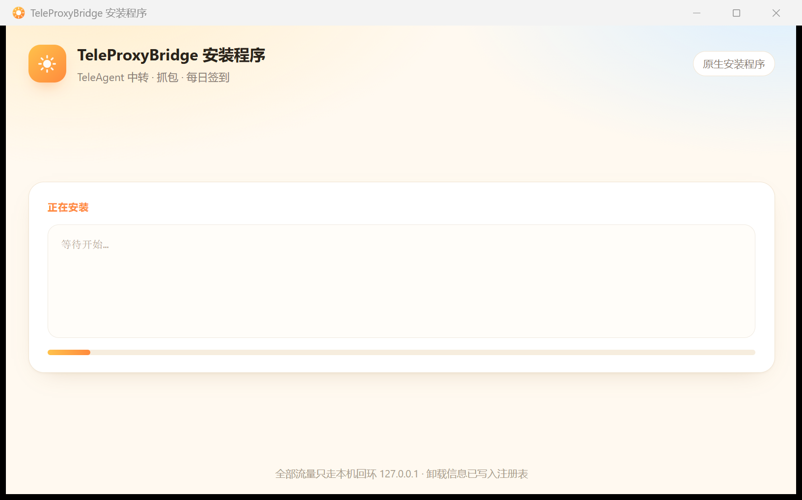
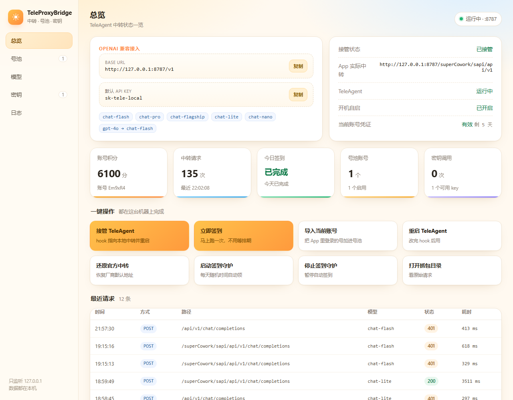
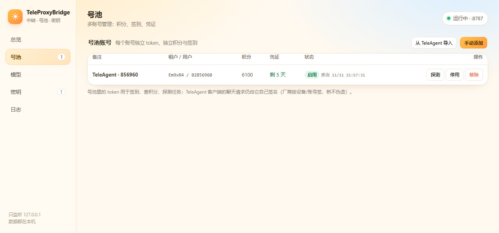
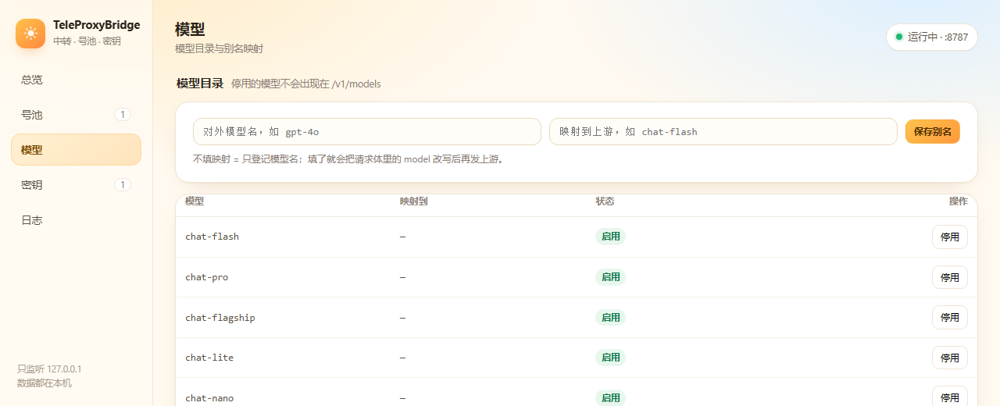
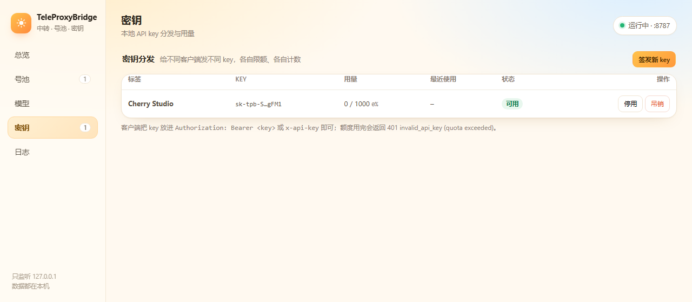

# tele-proxy-bridge

把 TeleAgent 桌面应用的模型请求接进本地桥（`127.0.0.1:8787`）：看得见、抓得到、改得了，还能顺手给别的客户端复用。

零依赖（只吃 Node 内置模块）。两种用法：装安装版 exe，或者直接双击 `TeleProxyBridge.cmd` 从源码跑。

---

## 0. 安装版 exe（原生 Tauri）+ 控制台（推荐）

`dist/TeleProxyBridge-Setup-1.0.0-native.exe`（36 MB，自带 node.exe，**不需要管理员权限**）：双击 → 选目录 → 开始安装。



安装程序本身是个**原生 Tauri 应用**（Rust + WebView2），不是自解压脚本：

- **Rust 后端**（`tauri-setup/src/main.rs`）做全部安装动作：内嵌 payload 解压（`include_bytes!` + `zip` crate）、起桥、写注册表卸载项（`winreg`）、建快捷方式、跑 `up`
- **WebView2 前端**（`tauri-setup/ui/index.html`）是真正的安装向导：显示探测到的 Node 版本 / TeleAgent 是否安装 / 桥是否在跑，实时打印安装日志
- **无控制台窗口**（`#![windows_subsystem = "windows"]`），单文件 exe；目标机不需要 Node、不需要 .NET 运行时（WebView2 是 Windows 10/11 自带）

它按顺序做完这些事（实测约 4 秒）：

1. 解压 18 个文件到 `%LOCALAPPDATA%\TeleProxyBridge`（含自带的 `node.exe`，目标机不需要装 Node）
2. 起桥 + 接管 TeleAgent hook + 注册开机自启 + 起签到守护（等于 `up --no-restart`）
3. 建桌面 + 开始菜单快捷方式（`launch.vbs`，无控制台窗口）
4. 写 `HKCU\...\Uninstall\TeleProxyBridge`，让「设置 → 应用」里能正常卸载
5. 打开控制台

静默安装（装机/批量时用）：

```powershell
.\dist\TeleProxyBridge-Setup-1.0.0-native.exe --silent --dir D:\Tools\TPB --no-autostart --no-shortcut
# 进度写到 %TEMP%\tpb-setup-silent.log，退出码 0 = 成功
```

### 在别人的电脑上（系统要求）

- **Windows 10 1809+ / Windows 11**。界面跑在 WebView2 上：Win11 自带，Win10 大多也自带，没有就打不开窗口——装一下微软的 WebView2 Runtime 即可
- **不需要**管理员权限、不需要装 Node、不需要 .NET 运行时（node.exe 打在包里）
- **需要装了 TeleAgent 并已登录**：现在的 token 和请求签名都来自它。安装器会自动找 TeleAgent.exe——先看环境变量 `TELEAGENT_EXE`，再扫注册表卸载项（`DisplayIcon` / `InstallLocation`），最后试 `%LOCALAPPDATA%\Programs\TeleAgent`、`%ProgramFiles%\TeleAgent`，**不写死任何盘符**，装到 D 盘也认得
- 要 `127.0.0.1:8787` 空着
- 代码里的路径全部走 `%USERPROFILE%` / `%LOCALAPPDATA%` / 注册表，没有个人机器残留；数据只在 `%LOCALAPPDATA%\TeleProxyBridge\data\`



控制台地址 `http://127.0.0.1:8787/ui`（只监听回环，别的主机连不上）。页面上能做的：

- 四个总览卡：TeleAgent 接入 / 签到守护 / 今日签到 / 登录凭证剩余天数
- 一键操作：接管 TeleAgent、重启 TeleAgent、立即签到、还原官方中转、起停签到守护、打开抓包目录
- 运行详情：hook 文件、App 实际用的中转地址、开机自启、签到时段、积分余额、下次执行时间
- 最近抓包表格（时间 / 方法 / 路径 / 状态 / 模型 / 耗时）
- 签到 / 中继日志（带高亮），每 5–6 秒自动刷新

左侧导航分五页：**总览 / 号池 / 模型 / 密钥 / 日志**。

### 号池（多账号）



- **从 TeleAgent 导入**：一键读当前客户端登录态（DPAPI + AES-256-GCM），加进号池
- **手动添加**：粘贴任意账号的 JWT（`Em9xR4:xxx` 里的那段也行），自动解出 tenant / userId / 过期时间
- 每行显示租户、用户、实时积分、凭证剩余天数、启停状态；支持**探测**（跑一次 `checkDayTask` + `points/detail`）、停用、移除
- 去重按 `tenant + userId`，重复导入只更新 token，不会堆垃圾行
- 数据落在 `data/pool.json`（已在 .gitignore），token 明文只存本机

**边界说清楚**：号池里的 token 能用来签到、查积分、探测任务；但 TeleAgent 客户端的**聊天请求是厂商按设备/账号签名**（`X-SuperAgent-*` + runtime AK/SK），桥不伪签，所以第三方客户端直连 `/v1` 仍然拿不到上游额度（实测 `401 {"code":40101}`）。

### 模型



- 列出 `openai.models` + 配置里的 `modelAliases`，可逐个**停用**（停用的不出现在 `GET /v1/models`）
- 加**别名**：对外叫 `gpt-4o`，请求体里的 model 改写成 `chat-flash` 再发上游

### 密钥分发



- **签发** `sk-tpb-…` 本地 key，可设**调用次数上限**（空 = 不限）
- 每个 key 独立计数、记录最近使用时间；**停用 / 吊销**立刻生效
- 客户端放 `Authorization: Bearer <key>` 或 `x-api-key`；额度用尽返回 `401 {"code":"invalid_api_key","message":"invalid api key (quota exceeded)"}`
- 配置里的静态 key（默认 `sk-tele-local`）照样可用，两者并存

入口：桌面快捷方式，或 `node src/cli.mjs ui`（用 Edge 的 `--app` 打开，看起来就是个原生窗口），或直接浏览器开 `http://127.0.0.1:8787/ui`。

卸载：控制面板「设置 → 应用 → TeleProxyBridge 控制台」，或 `node src/cli.mjs uninstall --yes`（先执行一遍不带 `--yes` 的可以看预演）。实测会清掉：中继进程、签到守护、开机自启、hook 还原、快捷方式、注册表卸载项、安装目录。

自己重新打包（改了源码之后）：

```powershell
./installer/build-tauri.ps1 -Version 1.0.0          # 默认：用本机 MSVC 工具链
./installer/build-tauri.ps1 -SkipNode              # 不带 node.exe（体积小，要求目标机有 Node）
./installer/build-tauri.ps1 -Gnu -Linker D:/msys64/mingw64/bin/gcc.exe   # 没有 MSVC/Windows SDK 的机器
```

打包机要求：

> **普通用户不需要编译**——直接下 `dist` 里的 exe。下面是给改代码的人看的。

- 只有 **Rust** 是必需的（`cargo build --release`）。Windows 上默认用 MSVC 工具链（装 Visual Studio Build Tools 的 C++ 组件即可）
- **没有 MSVC 的机器**才用 `-Gnu`：脚本会现写一份 `tauri-setup/.cargo/config.toml` 指向你的 gcc，**这份配置在 .gitignore 里，不会污染别人的构建**

（本机历史要求，留作参考）：

- **Rust**（rustup）。项目用 `rustup override set stable-x86_64-pc-windows-gnu` 把工具链钉在 **GNU** 上——这台机器没有 MSVC linker / Windows SDK，MSVC 目标链不起来
- **MinGW-w64 gcc** 当链接器（本机 `D:/perl/c/bin/gcc.exe`，用 `-Linker` 可改）
- 走 `rsproxy` 镜像拉 crate（`.cargo/config.toml`），首次构建约 2–3 分钟

重建图标（想换配色时）：

```powershell
cd tauri-setup; node make-icon.mjs    # 纯 Node 生成 icons/icon.ico（多尺寸 PNG-in-ICO）
```

**两个踩过的坑**（都已在代码里绕开）：

1. Kaspersky 会删掉 `csc /target:winexe` 编出来的 GUI exe（文件直接消失），所以 GDI/WinForms 老版本只能编成控制台程序 + 启动时自己 `ShowWindow(h,0)`；Tauri 版因为 `#![windows_subsystem="windows"]` 天生无控制台，不受影响
2. Kaspersky 也会拒绝执行**新链接出来的、被 strip 过的** build script（`os error 5, never executed`），所以 `Cargo.toml` 里给 `[profile.release.build-override]` 关掉了 strip

老的 .NET Framework 版安装包源码还在（`installer/Setup.cs` + `installer/build.ps1`），能不依赖 Rust 构建，作为兜底保留。

---

## 0.1 源码运行（就一步）

双击 `TeleProxyBridge.cmd` → 选 **1 开启桥接**。

它会自动做完这四件事（实测 9–11 秒）：

1. 在后台起桥（隐藏窗口，日志写 `bridge.log`，pid 写 `.tpb.pid`）
2. 把 `internal-debug.yaml` 的 `llmBaseUrl` 指到 `http://127.0.0.1:8787/superCowork/sapi`（原文件自动备份成 `.tpb-backup`）
3. 注册开机自启（`HKCU\...\Run` → `autostart.vbs`，隐藏窗口）
4. 重启 TeleAgent，并**读应用日志确认真的生效**：`newApiBaseUrl: 'http://127.0.0.1:8787/superCowork/sapi/api/v1'`

之后在 TeleAgent 里正常聊天，每个请求都会落到 `captures/requests.jsonl`。

菜单其它项：2 关闭并还原、3 状态、4 日志、5 打开抓包目录、6 建桌面快捷方式、7 签到状态、8 立即签到、9 打开控制台、0 退出。

想直接从桌面点开面板：根目录的 `launch.vbs`（隐藏窗口起 `ui`），桌面上已有「TeleProxyBridge 控制台」快捷方式指向它。
关掉菜单窗口不会停桥（桥是独立后台进程）；要停请用 2。

命令行等价物（供脚本/自动化用）：

| 命令 | 作用 |
| --- | --- |
| `node src/cli.mjs up` | 起桥 + 挂钩 + 自启 + 重启应用（`--no-restart` / `--no-autostart` / `--quiet`） |
| `node src/cli.mjs down` | 还原 hook + 撤自启 + 重启应用 + 停桥（`--keep-autostart` / `--no-restart`） |
| `node src/cli.mjs status` | 桥状态、hook 内容、应用日志里的实际地址、抓包条数、最后一条请求 |
| `node src/cli.mjs logs --lines 60` | 看桥日志（`--follow` 跟随） |
| `node src/cli.mjs doctor` | 全面体检：node / 配置 / 安装位置 / 登录态 / token 过期时间 / hook / 自启 |
| `node src/cli.mjs token` | 读当前登录态（DPAPI 解密，默认只看前 18 位，`--show` 打全） |
| `node src/cli.mjs signin` | 立刻签到一次（`--dry-run` 只看不领、`--force` 无视当日已跑） |
| `node src/cli.mjs signin --status` | 签到守护状态、随机窗口、今天计划/是否已领 |
| `node src/cli.mjs signin --start` / `--stop` | 起/停签到守护（`up` / `down` 会自动带上） |
| `node src/cli.mjs shortcut` | 建桌面快捷方式 |
| `node src/cli.mjs ui` | 起桥（没起的话）并打开控制台页面 |
| `node src/cli.mjs autostart on\|off\|status` | 开机自启开关 |
| `node src/cli.mjs uninstall` | 卸载预演；加 `--yes` 真删（含进程、自启、hook、快捷方式、注册表、目录） |

Node 找不到时 `TeleProxyBridge.cmd` 会按顺序找：`runtime\node.exe` → PATH → TeleAgent 自带的 `runtimes\node\node.exe` → `D:\app\TeleAgent\resources\node\node.exe` → `C:\Program Files\nodejs`。装了 TeleAgent 的机器基本不用另装 Node。

---

## 0.5 每日签到（积分福利社 daily_login）

`up` 会顺手把一个签到守护拉起来：每天在 **08:20–11:40** 里随机挑一分钟，领当天的 100 积分。窗口错过了（机器关机）当天仍会补签一次，最晚到 23:30。

### 它到底做了什么（全部实测，不是猜的）

从 `app.asar` 里挖到的真实调用链，和 app 自己点「立即领取」走的是同一条路：

| 步骤 | 请求 | 实测返回 |
| --- | --- | --- |
| 1. 读状态 | `GET https://agent.teleai.com.cn/superCowork/sapi/user/portal/companyStore/v3/checkDayTask?theme=light` | 200，`activity_data[]` 里有一条 `action_type:"api"`、`action_text:"今日已领"`、`jump_url:"/superCowork/sapi/user/portal/companyStore/checkTask?type=daily_login"` |
| 2. 领奖 | `GET <jump_url>`（去掉前缀后的路径再拼 origin） | 200 `{"code":200,"msg":"success","data":[]}`（今天已领过；没领过时 `data` 里是奖励） |
| 3. 回读余额 | `GET /user/portal/points/detail` | 200，`pointsBalance: 6100` |

只要 **`X-Token`**（app 的登录 token，DPAPI 解出来的那个），**不需要 `X-SA-*` 签名**——所以签到不依赖桥、不依赖 hook，桥关着也能跑。

来源：`app.asar` 里常量表 `{ACTIVE_USERCENTER, ACTIVE_DAYTASK:"/user/portal/companyStore/checkDayTask", ACTIVE_CHECK_DAILY_TASK:"/user/portal/companyStore/checkTask", NEW_ACTIVE_DAYTASK_V3:"/user/portal/companyStore/v3/checkDayTask", ACTIVE_Detail:"/user/portal/points/detail", ...}`，以及福利社组件里的领取逻辑 `D = async (task) => { const G = task.jump_url.replace("/superCowork/sapi",""); await pr(G) }`。

### 防封号是怎么做的

签到不是压测，越像人越好，所以：

- **一天最多一次**：`.signin-state.json` 记着当天是否已领，重复启动守护 / 重复双击菜单都不会重复请求。
- **随机时间**：每天在窗口内取一个随机分钟，用的是「日期种子」，重启守护也不会重新摇点（不会出现「每天 08:20:00 整点」这种机器指纹）。
- **单发不重试、失败有上限**：成功一次就收手；失败（token 过期、网络断）最多再试 3 次、每次间隔随机 1–15 分钟，仍不行就当今天放弃，明天照常，绝不整点为攻击面。
- **领取前随机停 2.5–9 秒**：不在同一个毫秒里连打两个接口。
- **token 过期就直接停**：不刷、不猜、不硬撞，等下次在 app 里登录。
- 没有 goto 到别的接口，不遍历活动、不刷积分。

### 证据

```
$ node src/cli.mjs signin --dry-run
token exp: 2026-11-16T17:59:52.000Z  tenant=Em9xR4
  info  checkDayTask -> HTTP 200 code 200
  info  task: 双11福利狂欢季🔥 | status=fixed | type=web | https://.../meter/teleagent/user/portal/campaign
  info  task: 每日可领100积分 | status=completed | type=api | /superCowork/sapi/user/portal/companyStore/checkTask?type=daily_login
  info  今天没有可领取的签到任务（可能已领过）
ok - 0 claim(s), 0.8s  [dry-run]
```

守守护日志（`signin.log`）会写清楚每一次的计划与结果：

```
[2026-11-11 19:25:03] next check-in 2026-11-11 19:39:03  (catchup, in 14 min)
```

### 边界（别指望它做不到的事）

- **必须在 app 里登录过**：token 从 `users/<owner>/app-auth/token.json` 解，没登录就没 token。当前这个 token 到 **2026-11-16** 过期，过期后在 app 里重新登录即可，守护自己会继续。
- **只领 app 里原本就能点的任务**：脚本只处理 `action_type:"api"` 且你自己的 `taskTypes`（默认 `daily_login`）里的项；网页类活动（`action_type:"web"`）不动。
- **没有验证过「未领取 → 领取成功」的完整一天**：今天（2026-11-11）测的时候已经领过了，接口回 `data:[]`；明天 09:xx 守护第一次真正领奖，日志会记下 `data` 内容。这是唯一一处「逻辑正确但没吃到真奖励」的地方。
- 服务端策略随时可能变（加验证码、改路径、加签名）——变了就重跑一遍 `signin --dry-run` 看哪一步断，别默默重试。

---

## 1. 最关键的坑：hook 地址必须带 `/superCowork/sapi`

TeleAgent 的 Go 内核会对「它实际 dial 的 URL」签名（`X-SA-Sign-Version: v1`、`X-SA-Timestamp`、`X-SA-Nonce`、`X-SA-Signature`）。上游按官方路径校验，所以：

| llmBaseUrl | 实际请求路径 | 上游结果（实测） |
| --- | --- | --- |
| `http://127.0.0.1:8787` | `/api/v1/chat/completions` | ❌ 401 `{"code":40104,"message":"invalid signature"}`（连续 6 次，含真实对话与记忆整理请求） |
| `http://127.0.0.1:8787/superCowork/sapi` | `/superCowork/sapi/api/v1/chat/completions` | ✅ 200 + SSE 流式返回（真实应用请求，230 个事件） |

所以 `bridge.config.json` 里 `hookPath` 默认是 `/superCowork/sapi`，桥会把这条路径原样送到 `https://agent.teleai.com.cn/superCowork/sapi/api/v1/...`，不增不减。
**别把 hook 改成裸地址**，那样桥是通的、应用是残的。

---

## 2. 架构

```
┌────────────────┐  /superCowork/sapi/api/v1/*  ┌────────────────────┐   https://agent.teleai.com.cn/superCowork/sapi/api/v1
│ TeleAgent 应用   │ ───────────────────────────▶ │ tele-proxy-bridge  │ ─────────────────────────────────────────────▶ 官方中继
│ (Go 内核 + UI)  │  头部（含 X-SA-* 签名）原样转发 │ :8787              │
└────────────────┘                              │  抓包 / 模型别名 / 失败转移 │
┌────────────────┐           /v1/*              │                    │
│ Cherry Studio   │ ───────────────────────────▶ │  OpenAI 兼容门面     │
│ Cline / 其它     │        Bearer sk-tele-local  │                    │
└────────────────┘                              └────────────────────┘
```

- **透传通道**：给 TeleAgent 自己用，逐字节转发（含 SSE），除 hop-by-hop 外不动头部——签名所以能过。
- **门面通道** `/v1/*`：给第三方客户端，要本地 key，可注入上游头部、可做模型别名、可多上游失败转移。
- **观测**：`captures/requests.jsonl`，SSE 会聚合成文本 + tool_calls + usage；`authorization` / `x-token` / `cookie` / `x-sa-signature` 默认打码。
- **id 连续**：`r000123` 这类序号写在 `captures/.seq`，重启桥不会倒回 `r000001`。

---

## 3. 已验证到哪一步（别把「能跑」当成「打通」）

| 项 | 结果 | 证据 |
| --- | --- | --- |
| 单元/集成测试 | ✅ 14/14 | `node --test test/bridge.test.mjs --test-force-exit`：透传、门面鉴权、模型别名、SSE 聚合、5xx 失败转移、头部打码、官方路径不重复拼接、签到选点/过滤/领取（对假 portal）/已领不重发、控制台页面与 admin 鉴权 |
| 安装版 exe 能装能卸 | ✅ | .NET 版：`--silent --dir <tmp>` 装完 18 文件 + `node.exe`、注册表卸载项、快捷方式、自启、hook 指向 8787，`/health` 200；`uninstall --yes` 后全清（三轮） |
| 原生 Tauri 安装包 | ✅ | `TeleProxyBridge-Setup-1.0.0-native.exe`（36 MB，Rust + WebView2）：`--silent --dir build\native-test` → 退出码 0，日志 `[done] 安装完成`，装出的桥在 8787 响应、`captures` 落在安装目录（不是当前工作目录）、注册表卸载项写入；带 `--no-autostart` 时 Run 键确实不被写 |
| Tauri 安装包卸载 | ✅ | 用注册表里的 `UninstallString` 跑：`uninstall entry: removed` / `hook: restored` / `deleting <dir>`，12 秒后目录消失、8787 无监听 |
| 工具链无 MSVC 也能编 | ✅ | 本机没有 `link.exe`/`Windows SDK`，走 GNU 工具链 + MinGW gcc 编出 release（`cargo build --release` 2m22s） |
| 控制台页面 | ✅ | `http://127.0.0.1:8787/ui` 200；面板点「立即签到」真的跑了 `checkDayTask -> HTTP 200` 并落到 `signin.log`、状态写成 `done` |
| 号池能导入与本机多账号 | ✅ | `account-import` 读到 `Em9xR4 / 2119672346402856960`（剩 5 天），`account-probe` 回 `积分 6100，任务 2`；重复导入按 tenant+userId 去重（单测覆盖） |
| 密钥分发与限额 | ✅ | 签发 `sk-tpb-…` 后调用 `/v1/chat/completions`：本地放行并计数（`used` +1），上游仍 `401`；错误 key 本地 `401 invalid_api_key`；超额 key 单测回 `reason=quota` |
| 模型别名与停用 | ✅ | `gpt-4o → chat-flash` 写入后出现在 `/admin/state.models` 与 `/v1/models`；停用项被过滤（单测覆盖） |
| 安装包/快捷方式带图标 | ✅ | `make-icon.mjs` 生成 7 尺寸 `icon.ico`（太阳标）；payload 带 `icon.ico`，快捷方式 `IconLocation` 指向它，窗口/任务栏用同一枚 |
| 换台电脑能不能装 | ⚠️ 部分验证 | 写死路径已清：TeleAgent 定位走「环境变量 `TELEAGENT_EXE` → 注册表卸载项（DisplayIcon/InstallLocation）→ 常见安装目录 → PATH」，本机就是从注册表认出来的（`D:\app\TeleAgent`）；`.cargo/config.toml` 不再入库，默认用 MSVC，`-Gnu` 才现写。**没在真实第二台机器上装过**，只在同一台机上模拟过干净安装 |
| 应用换了 token 存储也不瘫 | ✅ | 今天实测：应用把 `users/<owner>/app-auth/token.json` 清掉后，`doctor` 报 `session token - 来源=号池`，签到接口照样 `tasks=2`。解析顺序 应用 token → Chromium cookie → 号池 |
| 接入信息可一键复制 | ✅ | `/admin/state` 新增 `openai.{baseUrl,key,models}`；页面把它渲染成两个可点行（`http://127.0.0.1:8787/v1` / `sk-tele-local`），点击走 `navigator.clipboard`（回环是安全上下文），失败回退 `execCommand`，成功后行变绿 +「已复制 ✓」+ 底部 toast |
| hook 生效 | ✅ | 应用日志 `newApiBaseUrl: 'http://127.0.0.1:8787/superCowork/sapi/api/v1'` |
| 应用真实请求走桥并成功 | ✅ | `captures` 末条：`POST /superCowork/sapi/api/v1/chat/completions -> 200`，`ua=super-agent/1.0`，SSE 230 事件，正文是应用自己在做的记忆整理 |
| 一键开关可逆 | ✅ | `down` 后应用日志恢复到 `https://agent.teleai.com.cn/superCowork/sapi/api/v1`，hook 文件清空、桥停、自启撤销 |
| 第三方客户端直接借配额 | ⚠️ 未做 | 门面能收能转，但上游要 `X-SA-*` 签名，缺了就是 `401 {"code":40101,"message":"missing super agent security headers"}`。要过这关得拿官方 AK/SK 走签名，我不伪造 |
| 真人在 UI 里发一条消息 | ⚠️ 现状 | 需要你点，我替不了；但上面那条 200 的应用请求已经证明签名链路通了 |
| 签到接口可达 | ✅ | `signin --dry-run`：`checkDayTask -> HTTP 200`，读到 2 条任务（1 个 web 活动、1 个 `daily_login` 已领） |
| 签到守护会自己到点跑 | ✅ | 临时目录里把计划时间设到 25 秒后跑守护：`19:29:05 running check-in` → `19:29:06 check-in done (ok=true)` → `next check-in 2026-11-12 09:43`，第二次计划落在明天随机点 |
| 签到真的领到过一次奖励 | ⚠️ 未做 | 测试当天（2026-11-11）已经领过，接口回 `data:[]`。明天第一次真领，`signin.log` 会记下 `data` |

---

## 4. 配置（`bridge.config.json`）

| 键 | 默认 | 说明 |
| --- | --- | --- |
| `listen` | `127.0.0.1:8787` | 桥监听地址，别对外暴露 |
| `upstreams[]` | teleagent → `https://agent.teleai.com.cn/superCowork/sapi/api/v1` | `match` 决定哪些路径走它；可加第二个上游做失败转移 |
| `hookPath` | `/superCowork/sapi` | 见第 1 节，**别改** |
| `openai` | `/v1`，key `sk-tele-local` | 第三方门面；`models` 是 `GET /v1/models` 的返回 |
| `modelAliases` | `{}` | 入参模型名改写，例：`{"gpt-4o": "chat-flash"}` |
| `failover` | 429/5xx 换下一个上游 | 顺序重试 |
| `capture` | 开，`./captures` | `maxBodyBytes` 4MB 截断、`rotateBytes` 64MB 轮转、`redactHeaders` 打码名单 |

环境变量覆盖：`TPB_PORT` / `TPB_HOST` / `TPB_UPSTREAM` / `TPB_CAPTURE_DIR` / `TPB_CLIENT_KEYS` / `TPB_LOG_LEVEL`。

---

## 5. 目录

```
TeleProxyBridge.cmd          双击入口（菜单 + Node 自寻址）
launch.vbs                   隐藏窗口启动控制台（桌面快捷方式指向它）
autostart.vbs                开机自启用的隐藏启动脚本（注册在 HKCU Run）
bridge.config.json           生效配置
src/cli.mjs                  命令：up/down/status/logs/ui/serve/init/doctor/token/hook/signin/shortcut/autostart/uninstall
src/hook.mjs                 hook（internal-debug.yaml llmBaseUrl）读写与备份
src/admin.mjs                控制台后端：/admin/state、/admin/action、/admin/logs、静态页
src/webui/index.html         控制台前端（单文件，侧边导航：总览/号池/模型/密钥/日志）
src/pool.mjs                 号池 / 本地密钥 / 模型目录：持久化 data/pool.json，JWT 解租户与过期，key 限额计数
src/signin.mjs               每日签到：checkDayTask → 领取 → 读余额；随机窗口 + 补签 + 状态落盘
src/lifecycle.mjs            进程与生命周期：后台起停、pid、重启应用、读应用日志确认、自启、快捷方式
src/server.mjs               HTTP 服务、门面、转发编排
src/proxy.mjs                转发、URL 拼装（含官方路径规则）、模型别名、SSE 透传
src/capture.mjs              JSONL 抓包、打码、SSE 解析、序号持久化
src/config.mjs               配置默认值/加载/校验
src/teleagent/credentials.mjs  读登录态（DPAPI + AES-256-GCM）
src/teleagent/dpapi.ps1      DPAPI 解包 os_crypt key
test/bridge.test.mjs         集成测试（真起 http 对打）
scripts/summarize-captures.mjs  抓包速览
tauri-setup/src/main.rs      原生安装器后端（Rust：解压 payload、起桥、注册表、快捷方式、静默模式）
tauri-setup/ui/index.html    原生安装器前端（WebView2 里的安装向导）
tauri-setup/tauri.conf.json  Tauri 配置（窗口 920x545、withGlobalTauri）
tauri-setup/Cargo.toml       依赖：tauri 2 / zip / winreg；build-override 关 strip（绕杀软）
tauri-setup/make-icon.mjs    零依赖生成 icons/icon.ico（多尺寸 PNG-in-ICO 太阳图标）
tauri-setup/.cargo/config.toml  钉 GNU 工具链 + MinGW 链接器 + rsproxy 镜像
installer/build-tauri.ps1    打包脚本 → dist/TeleProxyBridge-Setup-<ver>-native.exe（推荐）
installer/Setup.cs           老版安装器源码（WinForms，兜底，不依赖 Rust）
installer/build.ps1          老版打包脚本 → dist/TeleProxyBridge-Setup-<ver>.exe
dist/                        产出物（已在 .gitignore）
docs/RECON.md                逆向记录：路径、header、签名、死路复盘
docs/panel.png               控制台截图（新版阳光界面）
docs/setup-tauri.png         原生安装程序截图
captures/requests.jsonl      请求/响应记录（已在 .gitignore）
bridge.log                   桥日志
```

---

## 6. 风险与边界

- **只在 127.0.0.1 起服务**；门面 key 是占位符 `sk-tele-local`，别拿去公网。
- **不要伪造签名**。桥能做的是「转发应用自己签好的请求」，做不到「替客户端生成有效请求」。号池管的是账号（token/积分/签到），不是厂商签名。
- **号池 ≠ 免费上游**：把号池当成给第三方客户端发电的池子，需要伪造 `X-SuperAgent-Signature`（厂商按设备+账号签），实测缺签名一律 `401 40101`。桥不做这件事。
- **应用升级会变**：`internal-debug.yaml`、`sDe(t) = t + '/api/v1'`、签名头都来自 3.0.0 这一版；升级后先跑 `doctor` 和 `hook status`。
- **抓包含业务内容**：默认打码凭据头，但正文是明文，注意别外传。
- **自启是本机策略的妥协**：本机往「启动」文件夹写 `.vbs` 会被拦（EPERM），所以走 `HKCU Run` + 项目内 `autostart.vbs`。
- 这是本地调试/观测工具，不是绕过计费或与他人共享账号的方案；账号规则自己掂量。
- **只支持 Windows**：DPAPI 读凭据、PowerShell 建快捷方式、注册表卸载项、`taskkill` 全依赖 Win32；Linux/macOS 跑不了主链路。
- **必须装了 TeleAgent**：token 和请求签名都来自它。没有客户端时，号池那套（签到/积分/探测）还能用，但聊天链路不存在。
- **端口 8787 被占**：桥起不来，`up` 会报错退出。改端口要同时改 `bridge.config.json` 的 `listen` 和 `hookPath` 对应的地址。
- **WebView2 缺失**：安装器窗口打不开（Windows 10 1809 之前的版本），装个 WebView2 Runtime 即可。
